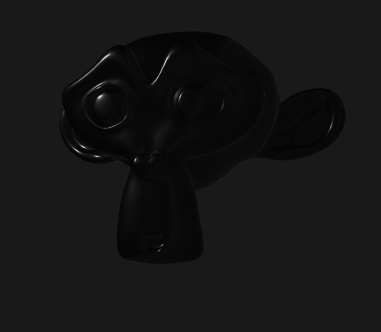
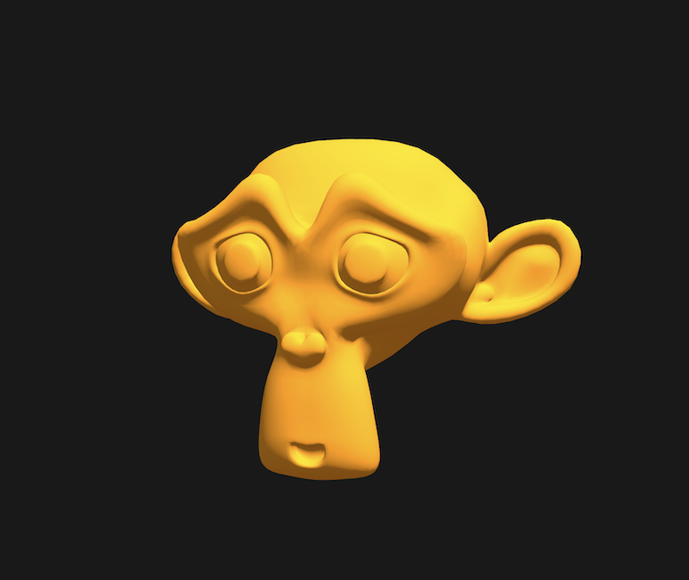
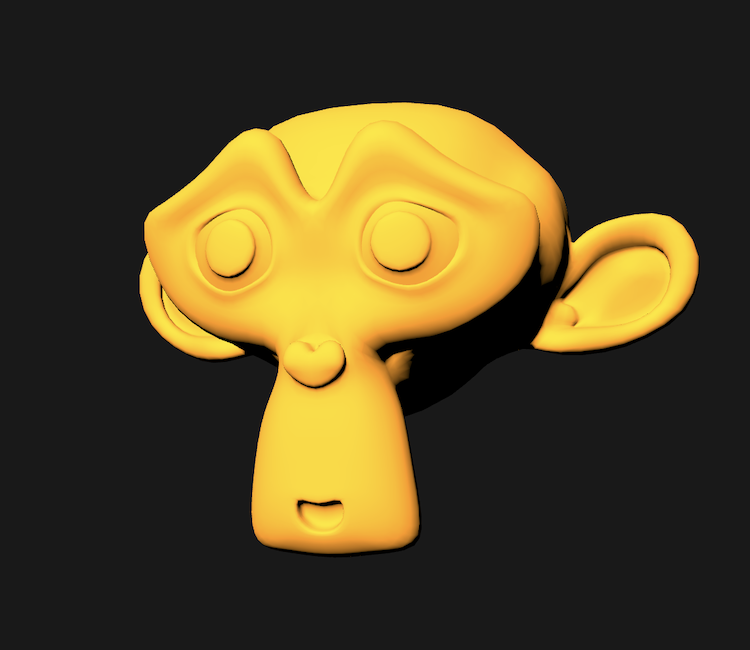
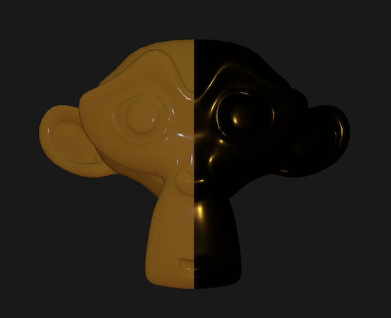
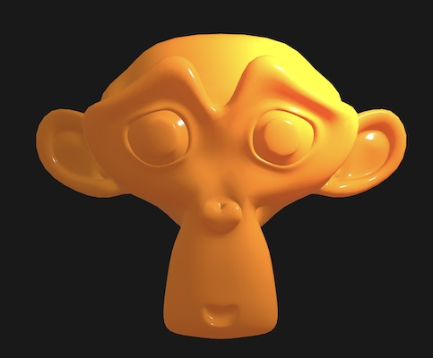

# BRDF from Scratch

A physically based BRDF written by hand, term by term, in a single GLSL fragment shader.

This is the companion code for my four-part blog series *Writing a BRDF from Scratch*, part of a [60-day technical art writing experiment](https://www.artstation.com/stefangroenewoud/blog). Instead of relying on an engine's built-in shading model, I wanted to build one myself to see where my understanding held up and where it didn't.



---

## What's in it

| Part | Post | Adds |
|---|---|---|
| 1 | [Writing a BRDF from Scratch](https://www.artstation.com/stefangroenewoud/blog) | Albedo, Lambertian diffuse, hemisphere ambient |
| 2 | [Writing a BRDF from Scratch (Part 2)](https://www.artstation.com/stefangroenewoud/blog) | Burley diffuse, GGX specular, height-correlated Smith visibility, Schlick Fresnel |
| 3 | [Writing a BRDF from Scratch (Part 3)](https://www.artstation.com/stefangroenewoud/blog) | Metallic workflow, and where a texture-less previewer hits its limit |
| 4 | [Writing a BRDF from Scratch (Part 4)](https://www.artstation.com/stefangroenewoud/blog) | Cheap translucency approximation |

Everything lives in one file: [`shaders/brdf.frag`](shaders/brdf.frag). A `STEP` define at the top switches between the four parts, so you can follow the series in order.

---

## Running it

The shader renders an analytic sphere over the full screen, so it needs no meshes and no textures. It only expects two uniforms:

```glsl
uniform vec2  u_resolution;
uniform float u_time;
```

**glslViewer**

```bash
glslViewer shaders/brdf.frag
```

Change `#define STEP 4` at the top of the file to `1`, `2` or `3` to view earlier parts. The light orbits the sphere over time, so you can see the specular, the Fresnel rise and (in Part 4) the back-lit translucency.

**Shadertoy**

Rename the entry point and uniforms:

```glsl
void mainImage(out vec4 fragColor, in vec2 fragCoord)
// u_resolution -> iResolution.xy
// u_time       -> iTime
// gl_FragCoord -> fragCoord
// gl_FragColor -> fragColor
```

---

## The math

The specular lobe is a Cook-Torrance microfacet model:

$$
f_r(\mathbf{l}, \mathbf{v}) = D(\mathbf{h}) \, V(\mathbf{l}, \mathbf{v}) \, F(\mathbf{v}, \mathbf{h})
$$

where $V$ already folds in the $\frac{1}{4 (\mathbf{n} \cdot \mathbf{l})(\mathbf{n} \cdot \mathbf{v})}$ denominator.

**D — GGX normal distribution function.** Controls the shape of the highlight. Roughness is remapped as $\alpha = \text{roughness}^2$ so the slider feels perceptually linear.

$$
D(\mathbf{h}) = \frac{\alpha^2}{\pi \left( (\mathbf{n} \cdot \mathbf{h})^2 (\alpha^2 - 1) + 1 \right)^2}
$$

**V — height-correlated Smith visibility.** Accounts for microfacets shadowing and masking each other at grazing angles.

$$
\Lambda(\omega) = \frac{-1 + \sqrt{1 + \alpha^2 \tan^2 \theta_\omega}}{2}
\qquad
V = \frac{1}{1 + \Lambda(\mathbf{l}) + \Lambda(\mathbf{v})} \cdot \frac{1}{4 (\mathbf{n} \cdot \mathbf{l})(\mathbf{n} \cdot \mathbf{v})}
$$

**F — Schlick Fresnel.** Drives the reflectance rise at grazing angles, using the spherical-gaussian approximation of the fifth power.

$$
F = F_0 + (F_{90} - F_0)(1 - \mathbf{l} \cdot \mathbf{h})^5
\approx F_0 + (F_{90} - F_0) \, 2^{(-5.55473 u - 6.98316) u}
$$

**Diffuse — Burley.** Replaces Lambert so roughness also affects the diffuse response: softer at grazing angles, slight retro-reflection on rough surfaces.

$$
f_d = \frac{c_{\text{diff}}}{\pi} \, F_S(\mathbf{n} \cdot \mathbf{l}, 1, f_{90}) \, F_S(\mathbf{n} \cdot \mathbf{v}, 1, f_{90}),
\qquad
f_{90} = 0.5 + 2 \, \alpha \, (\mathbf{l} \cdot \mathbf{h})^2
$$

**Metallic.** Metals have no diffuse, and their specular reflectance takes the base colour:

$$
c_{\text{diff}} = \text{albedo} \cdot (1 - m)
\qquad
F_0 = \text{lerp}(0.04, \text{albedo}, m)
$$

---

## Screenshots from the series

| Part 1 — Lambert + ambient | Part 2 — Burley diffuse | Part 3 — Metallic | Part 4 — Translucency |
|---|---|---|---|
|  |  |  |  |

These were captured in the original previewer used for the posts. Part 2's animated breakdown is in [`docs/media/day-52-brdf.mp4`](docs/media/day-52-brdf.mp4).

---

## Known limitations

- **No real specular ambient.** A correct term needs image-based lighting: a prefiltered environment map and a BRDF lookup table (the split-sum approximation). The original previewer had no texture sampling, which is the wall Part 3 runs into. This version substitutes the hemisphere colour along the reflection vector, clearly marked in the code as an approximation.
- **No diffuse/specular energy balance.** Diffuse is not scaled by $(1 - F)$, and there is no multi-scattering compensation for rough metals.
- **Translucency is a cheap look, not subsurface scattering.**

## Next steps

- Split-sum IBL: prefiltered cubemap + BRDF LUT (see my post *How IBL Works*)
- $(1 - F)$ energy split and multi-scattering compensation
- Port to an engine with texture support to drive albedo, roughness and metalness from maps

---

## References

- Brent Burley, *Physically Based Shading at Disney*, SIGGRAPH 2012
- Walter, Marschner, Li, Torrance, *Microfacet Models for Refraction through Rough Surfaces*, EGSR 2007
- Eric Heitz, *Understanding the Masking-Shadowing Function in Microfacet-Based BRDFs*, JCGT 2014
- Brian Karis, *Real Shading in Unreal Engine 4*, SIGGRAPH 2013
- Sébastien Lagarde, Charles de Rousiers, *Moving Frostbite to Physically Based Rendering*, SIGGRAPH 2014
- Romain Guy, Mathias Agopian, *Physically Based Rendering in Filament*

---

## License

Code is released under the [MIT License](LICENSE).
Blog text and images are © Stefan Groenewoud, licensed under [CC BY-NC 4.0](https://creativecommons.org/licenses/by-nc/4.0/).
